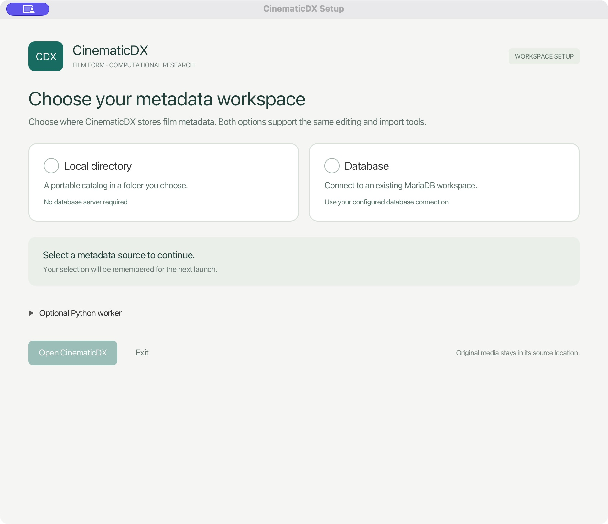
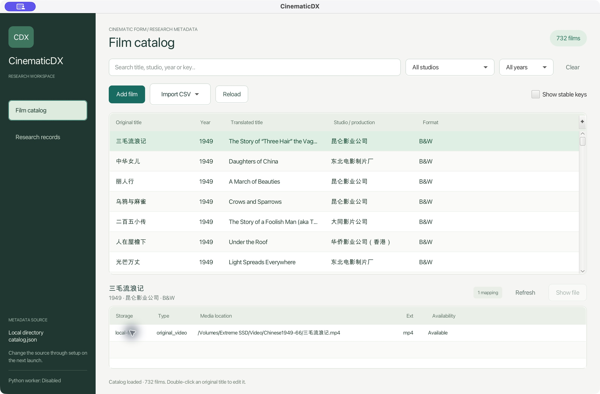
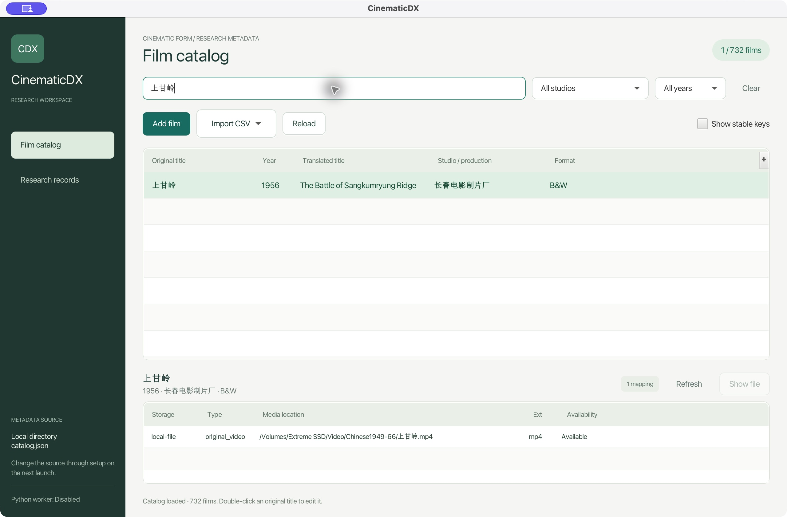
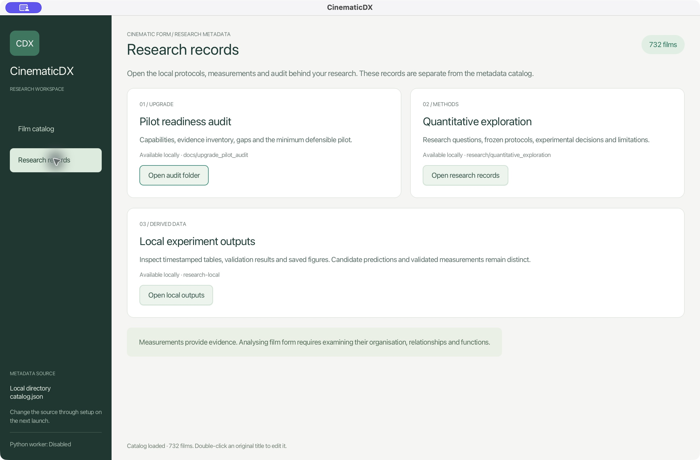

# Desktop workspace

The interface remains a JavaFX desktop application. Metadata storage and research measurements remain separate. This refresh adds readable navigation and catalog filtering without changing the existing SQL schema or introducing a web dashboard.

## Setup



Choose **Local directory** or **Database** explicitly. Both choices retain film editing, CSV imports, typed attributes and media mappings. Previously saved source selection is restored, but setup is still shown before opening it.

- Local directory: browse to an existing folder containing `catalog.json`, or choose **Create local catalog…** explicitly. Choosing a folder never creates or overwrites a catalog. Local opening does not connect to JDBC or fall back to the database.
- Database: supply the existing connection URL and credentials. Remembered database settings are preserved when using local mode and vice versa.
- The optional Python worker is common to both modes. It is a process-lifecycle facility; the standalone analysis commands remain separate.

Normal configuration is `~/.cinematicdx/cinematicdx.properties`. An explicit `-Dcinematicdx.config=/path/to/file` selects isolated settings and does not import legacy settings into that file. `-Dcinematicdx.workspace=/path/to/CinematicDX` selects the repository containing local research records. No live backend switch is introduced.

## Catalog



Search is literal and case-insensitive, including Chinese titles, translated titles, romanised fields, keys, production labels, year and format. Whitespace-separated search terms must all match. Combine search with the production-label and year selectors; **Clear** resets all three.

The production selector matches the catalog's complete production field. Joint-production strings are separate choices; this is a metadata browser, not the research pipeline's institution-membership grouping or fractional weighting. Unknown years remain selectable rather than being invented.

The top count distinguishes visible records from total catalog size. Empty catalogs and empty filtered results have different prompts. Column sorting remains available; the table's column menu reveals optional columns. **Show stable keys** stays synchronised with column visibility. Double-click an original title to rename it without changing the film key.

**Add film** and **Import CSV** retain the existing review/duplicate/overwrite workflows. Film, attribute and media imports are grouped in the import menu.

## Selected film and media



The lower area follows the selected film and displays its recorded year, production and format. Media mappings show location, type and local availability. Select a mapping to enable **Show file**, which uses the existing system-file-browser workflow. An empty search clears stale film/media details. A missing mapping is not a missing-film measurement or a zero-valued research result.

## Research records



The research page checks whether the Upgrade audit, methodology record and local output directory actually exist. Missing folders disable their actions. Buttons open the corresponding local folder in the system file browser; they do not run extraction, upload media or create statistics. The research note preserves the distinction between property measurements and analysis of film form.

## About the screenshots

All screenshots were captured from the actual running application using the native app surface; none is a design mock-up. The metadata preview was a new, isolated local catalog created through existing CSV/store operations. It contains 732 basic metadata rows from the user's available research JSON and 453 references from the already verified source registry. It does not replace the original inventory, create a production JSON-import feature or imply that all records have accessible videos. Catalog keys follow the existing catalog rules and are not silently substituted for research-inventory identifiers.

The year selector returned 43 rows for 1956. The exact `长春电影制片厂` production label combined with 1956 returned 15 metadata rows, independently checked against the CSV input. This count is a catalog result, not the number of validated film measurements in that group.

The preview catalog/settings live under ignored `research-local/gui-preview-20261026/`; original videos, research measurements and normal global preferences were left unchanged. Source data and the generated app/runtime remain local. The repository includes screenshots, source, tests and launch/package scripts.

## Run and build

From the repository root:

```sh
./scripts/run-desktop.sh
./scripts/package-desktop-macos.sh
```

The package is created in `cinematic/target/desktop/CinematicDX.app`; move an existing generated app before repackaging. Each packaging run uses a fresh dependency input folder to avoid mixing stale dependency versions. An installed JDK with `jpackage` is required; the verified native preview used the machine's JDK 17. The source release remains Java 11.

OpenJFX is pinned to 17.0.18. Apple Silicon targets are supported by the JavaFX 17 line; see the [official OpenJFX platform documentation](https://github.com/openjfx/javafx-gradle-plugin#4-cross-platform-projects-and-libraries). Maven resolves the architecture corresponding to its JDK. No computer-vision models are part of this desktop build.
