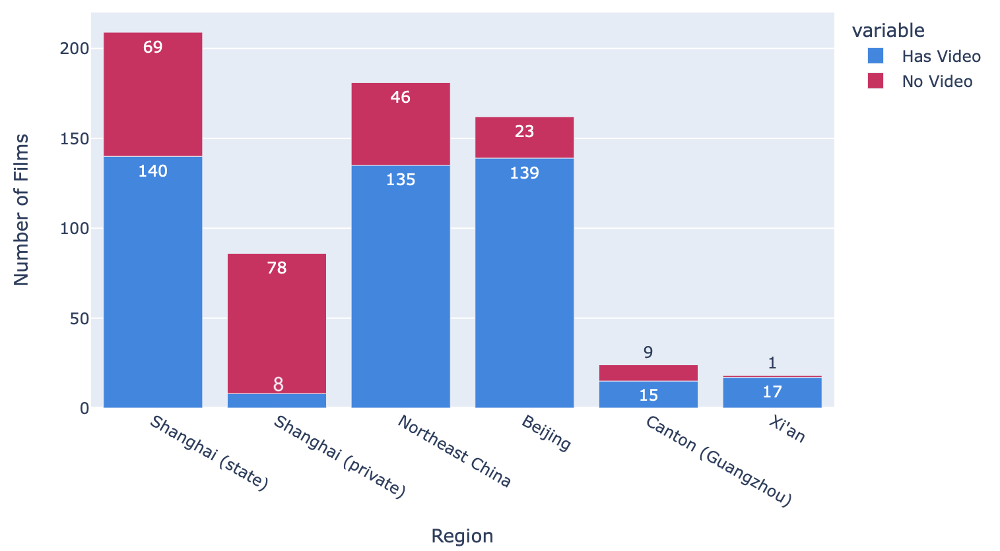
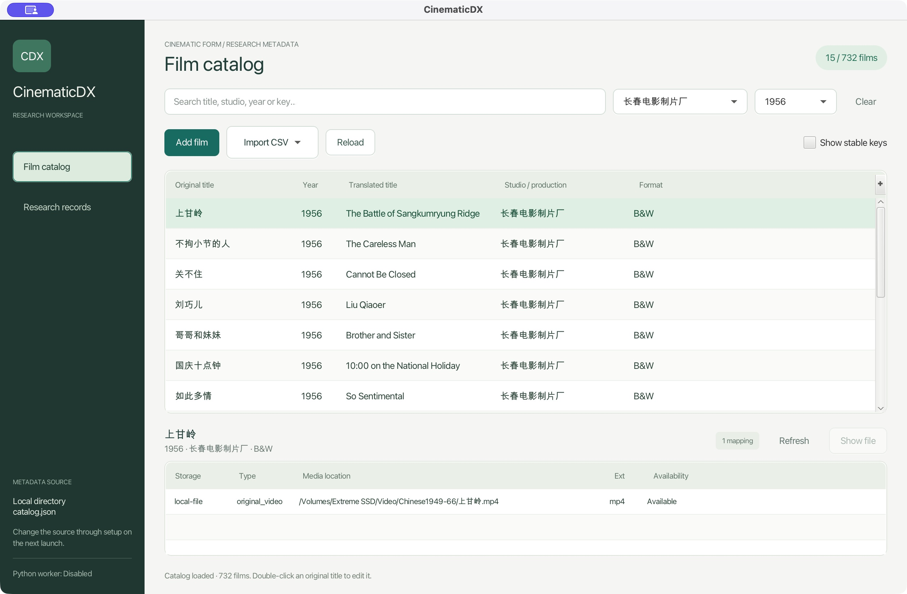

# CinematicDX

Computational research infrastructure for *Negotiating Film Form: Computational Approaches to Twentieth-Century Political Cinema*.

## Contents

- [Latest research data, 10 November 2026](#latest-research-data-10-november-2026)
- [July 2026: standalone hard-cut detection experiment](#july-2026-standalone-hard-cut-detection-experiment)
- [Chinese Political Cinema Case Study Corpus Sourcing](#chinese-political-cinema-case-study-corpus-sourcing)
  - [Film Archiving in China](#film-archiving-in-china)
  - [Data Modelling](#data-modelling)
  - [Named Entity Detection](#named-entity-detection)
- [Desktop update, 28 October 2026](#desktop-update-28-october-2026)
- [Desktop workspace](#desktop-workspace)
- [Metadata sources and setup](#metadata-sources-and-setup)
- [Methodological Vision: LoD-Aware Corpus Design for Computational Film Analysis](#methodological-vision-lod-aware-corpus-design-for-computational-film-analysis)
  - [Corpus as Database, Not Just Metadata](#corpus-as-database-not-just-metadata)
  - [JavaFX as a Reading and Visualisation Interface](#javafx-as-a-reading-and-visualisation-interface)
  - [Why Distance and LoD Matter for Humanistic Evidence](#why-distance-and-lod-matter-for-humanistic-evidence)

## Latest research data, 10 November 2026

The current corpus contains 454 videos. Three replacement sources have new grey-level and frame-complete editing measurements. All institutional summaries, timelines and sensitivity comparisons have been recomputed. The [current results release](research/quantitative_exploration/corpus_refresh/20261110/README.md) includes downloadable CSV tables, figures, source-version changes and validation records. Codex assisted the refresh and audit.

## July 2026: standalone hard-cut detection experiment

In July 2026, a standalone feasibility experiment tested automated hard-cut detection alongside exploratory algorithms intended to identify possible metric-montage sequences. In Eisenstein’s [“Methods of Montage”](https://kristintripp.com/wp-content/uploads/2014/09/eisenstein_montage.pdf), *metric montage* organises editing through absolute shot lengths and recurring proportional patterns; acceleration can be produced by shortening units while preserving their proportions. The exploratory code searched for consecutive shot durations approximating integer multiples of a base length, using either a fixed base or a range of possible bases. These sequences were candidates for inspection, rather than verified instances of metric montage. Incorporation into CinematicDX was conditional on reliable hard-cut detection. The default PySceneDetect configuration used in the trial produced highly inaccurate detections on the black-and-white material tested, undermining the shot-length sequences required by the subsequent analysis. The trial was therefore discontinued, and its detection workflow and montage algorithms were not integrated into CinematicDX. The [separate experiment archive](https://github.com/El-Mundo/july-2026-metric-montage-experiment) preserves the notebooks, code and exploratory outputs as a record of this unsuccessful approach.

## Chinese Political Cinema Case Study Corpus Sourcing

Converted from Chapter 2 of the 2023 design report. The tables, figure and coverage percentages describe that study’s sampling framework. Current corpus measurements are available in the [10 November 2026 results release](research/quantitative_exploration/corpus_refresh/20261110/README.md).

### Film Archiving in China

Collecting metadata for a large-scale film corpus requires rigorous use of documentation published by film archives. In a study on the Soviet film director Dziga Vertov, Adelheid Heftberger demonstrated the benefits of using documents provided by official film archiving institutions to understand the conditions of film production.[^corpus-sourcing-1] However, it was revealed in this project that reliance on official documents as the only data source would potentially impair the integrity of the corpus.

Initially, I focused on *The Catalogue of Chinese Artistic Films* (shortened as *The Catalogue*) and *The Encyclopedia of Chinese Films* (*The Encyclopedia*) as the main sources for data collection in this project.[^corpus-sourcing-2] These two books were published by the China Film Archive (CFA), the largest film preservation agency in the People’s Republic of China (PRC). Both books were supposed to be authoritative publications, but there was a significant discrepancy in their coverage of films produced by private film companies in Shanghai between 1949 and 1953.

| Source | All Entries | Films from Private Studios in Shanghai |
| --- | ---: | ---: |
| *The Catalogue* | 656 | 24 |
| *The Encyclopedia* | 722 | 85 |
| This Project | 732 | 86 |

*Table 1*. Entry counts in the two books and this project.[^corpus-sourcing-3]

The difference between the two books raised caution regarding the use of official documentation. *The Catalogue* published in 1981 omitted 61 films produced by private companies in Shanghai that could be found in *The Encyclopedia* published in 2001 (*Table 1*).[^corpus-sourcing-4] In addition to the efforts paid by CFA researchers in discovering lost media, this difference is also related to the relationship between mainland China and Taiwan. Many private filmmaking institutions in Shanghai had intimate relationships with the government of the Republic of China (ROC) in the 1940s.[^corpus-sourcing-5] After the PRC took over mainland China in 1949 and the ROC government moved to Taiwan, the tension between the mainland and Taiwan lasted for decades until it started to ease gradually in 1979.[^corpus-sourcing-6] This tension was also reflected in *The Catalogue*’s selective inclusion of films from Shanghai’s private film companies, as these companies used to be cultural institutions serving the ROC. The representability of filmographies published by official organisations could be directly influenced by political demands, so the combination of official and informal sources would be necessary to ensure the coverage of the film corpus. By combining and comparing the information from *The Catalogue*, *The Encyclopedia*, the filmography of mainland China written by Donald J. Marion,[^corpus-sourcing-7] and two online databases (*1905.com* and *Douban*), I constructed a collection containing the metadata for 732 films as the base corpus for this project.[^corpus-sourcing-8]

### Data Modelling

I selected *The Catalogue* as the main reference for data modelling. While *The Catalogue* was limited in coverage due to its selective inclusion of films from Shanghai’s film companies, this 1981 book still contained valuable first-hand materials about the conditions of filmmaking in mainland China. These materials were collected by CFA-funded researchers in collaboration with state-owned film studios of the PRC and provided some exclusive information, such as the number of film reels and special techniques (e.g. widescreen film reels imported from the Soviet Union) used by a film. Therefore, I used texts extracted from *The Catalogue* with Optical Character Recognition (OCR) as the primary source for data modelling.

| Attributes | Available Samples |
| --- | ---: |
| Title (Chinese) | 732 |
| Translated Title (English) | 732 |
| Release Year | 732 |
| Studio(s) | 732 |
| Colour | 731 |
| Film Reels | 656 |
| Staff and Crew | 732 |

*Table 2*. The data model.



*Figure 1*. Video data coverage.[^corpus-sourcing-9]

I designed the data model based on the attributes available in the book (*Table 2*). Five filmmaking regions were then identified by mapping the films to the geographical locations of film institutions. After removing entries from minor filmmaking regions (where the total number of films produced between 1949 and 1966 was less than ten) and co-produced entries that could not be located in a single region, a list with 680 entries was generated, and the video data of 454 entries were collected from *1905.com*, the official film database of mainland China run by China Central Television (*Figure 1*). This video dataset covered 75.59% of all films produced by state-run studios in the five investigated regions between 1949 and 1966.

The data modelling process also revealed a critical limitation of Chinese OCR technology. Although *The Catalogue* was published in simplified Chinese, it contained some characters that are now only used in traditional Chinese. The mixed usage of simplified and traditional Chinese characters was common in publications in mainland China from the 1950s to the 1980s, as the replacement of traditional Chinese with simplified Chinese was a gradual process.[^corpus-sourcing-10] However, mainstream OCR libraries, such as Tesseract and EasyOCR, usually consider simplified and traditional Chinese as two distinct languages, resulting in inaccuracies in digitalising these books. This limitation of Chinese OCR reflects the general lack of digital preservation for historical documents published in mainland China. To ensure the precision of the OCR results, the extracted data was checked by human proofreaders before modelling.

Another issue disclosed in data modelling was the over-reliance on direct translation and Pinyin in existing filmographies of China. For instance, Marion’s filmography used Pinyin unanimously to represent names of ethnic minorities, while Pinyin is typically used for Han-Chinese names. *The Encyclopedia* directly translated a 1958 film co-produced by Chinese and French institutions as *The Kite* rather than its original title *Cerf-volant du Bout du Monde*. The homogeneous usage of Pinyin assumed that all names written in the Chinese language were of Han-Chinese nationality but neglected China’s cultural diversity and practices of transnational film production. With the awareness of this issue, I appended a translated list of all non-Chinese and ethnic-minority names to this project.[^corpus-sourcing-11] This list obeyed the conventions of Romanising different languages rather than solely relying on Pinyin. As some Soviet and French filmmakers had collaborated with Chinese film studios in the investigated period and were included in the metadata, the translation of their names provided in this list may also interact with future research projects about the transnational filmmaking practices in the PRC.

### Named Entity Detection

I used named entity detection to find all individuals appearing in the crew and staff information of the 732 films, but this method could not identify duplicate names. By manually checking the appearances of some common Chinese names that may cause name duplication, I found that name duplication was rare in mainland China’s film industry in the studied period. The only known case of a duplicate name is “Li Lingyun (李凌云),” a name shared by a female actor and a male composer.

[^corpus-sourcing-1]: Adelheid Heftberger, *Digital Humanities and Film Studies: Visualising Dziga Vertov’s Work*, Quantitative Methods in the Humanities and Social Sciences (Cham: Springer International Publishing, 2018).

[^corpus-sourcing-2]: Fenglan Jin and Zhengduo Yang, *中国艺术影片编目 [The Catalogue of Chinese Artistic Films]* (Beijing: Culture and Art Publishing House, 1981); China Film Archive, *中国影片大典：故事片，舞台艺术片，1949.10-1976 [Encyclopaedia of Chinese Films, 1949.10-1976]*, 1st edn (Beijing: China Film Press, 2001).

[^corpus-sourcing-3]: *The Encyclopedia* included 27 entries produced in Hong Kong or Taiwan. These films are excluded in the statistics.

[^corpus-sourcing-4]: According to a 2005 report of China Film Archive, there were 2298 films produced in mainland China between 1905 and 1949, but only 331 of them were preserved. See Tongsheng Zhao, *电影档案概论 [Introduction to Film Archiving]* (Beijing: China Radio, Film and Television Press, 2005).

[^corpus-sourcing-5]: Yingjin Zhang, *Chinese National Cinema*, 1st edn (New York; London: Routledge, 2004), pp. 97–99.

[^corpus-sourcing-6]: Kevin G. Cai, *Cross-Taiwan Straits Relations since 1979 Policy Adjustment and Institutional Change across the Straits* (Singapore; Hackensack, NJ: World Scientific, 2011).

[^corpus-sourcing-7]: Donald J. Marion, *The Chinese Filmography: The 2444 Feature Films Produced by Studios in the People’s Republic of China from 1949 through 1995* (Jefferson, NC; London: McFarland & Co, 1997).

[^corpus-sourcing-8]: ‘ChineseCinema’, 2023 <https://github.com/FilmPreservation/ChineseCinema> [accessed 8 June 2023].

[^corpus-sourcing-9]: Considering some geopolitical conventions of China, the Northeast China category is presented to include one film collaboratively made by Changchun Film Studio and Harbin Film Studio, and the Canton category includes six entries produced in collaboration with Hong Kong institutions.

[^corpus-sourcing-10]: Daniel Kane, *Chinese Language: Its History and Current Usage*, 1st edn (North Clarendon, VT: Tuttle Publishing, 2006).

[^corpus-sourcing-11]: ‘Romanised Names’, 2023 <https://github.com/FilmPreservation/ChineseCinema/blob/main/OCR/JAVA/romanizing/roman-non-han_names.csv> [accessed 14 June 2023].

## Desktop update, 28 October 2026

**GUI and interaction experience improvements using Codex.** The desktop refresh and its supporting metadata/research code are now published on the main development line, `master`. The `codex/quantitative-evidence-20261026` branch records the development work; its name identifies the workflow rather than a separate source of research authority.

For collaborators, the [update summary](CHANGELOG.md) describes the publication scope and the [AI-assistance disclosure](docs/AI_ASSISTANCE.md) distinguishes Codex-assisted code and reporting from researcher-supplied questions and independent manual annotations. The [24-slide preliminary-results presentation](docs/presentations/20261028/README.md) includes measurement procedures, validation and limitations. Independent coauthor review or approval is not implied by publication.

## Desktop workspace

The JavaFX desktop workspace now provides parallel local-directory/database setup, live catalog search, exact production-label and year filters, optional stable keys, linked-media availability, and direct access to local research records and the Upgrade audit. The interface does not turn candidate predictions into validated film measurements.



These screenshots show the macOS application with a private preview catalog populated from the research inventory through the CSV workflow. The original inventory, videos, annotations and experimental caches remain local. New users create/open their own catalog.

```sh
./scripts/run-desktop.sh
```

Maven is required; the script also detects an existing Maven wrapper cache. Java source/module compilation targets Java 11. The tested Apple Silicon desktop preview uses an installed JDK 17 and OpenJFX 17.0.18. On macOS, an installed JDK 17 is selected when `JAVA_HOME` is unset. Dependencies are resolved through Maven Central on the first build.

```sh
./scripts/package-desktop-macos.sh
```

The packaging command creates `cinematic/target/desktop/CinematicDX.app` with a local runtime. It requires an installed JDK with `jpackage` and refuses to overwrite an existing app. Move the previous generated app before rebuilding. For isolated settings use `./scripts/run-desktop.sh -Dcinematicdx.config=/path/to/preview.properties`; packaging accepts the equivalent `CINEMATICDX_CONFIG` environment variable. Normal launches keep the app-wide settings described below.

See [usage and screenshots](docs/gui/README.md), [GUI verification](docs/gui/VERIFICATION.md), and the [Upgrade pilot readiness audit](docs/upgrade_pilot_audit/CURRENT_STATE.md). The historical research outputs referenced by the audit remain local; their code and protocols are included.

## Metadata sources and setup

CinematicDX supports two parallel metadata sources: **Local directory** and **Database**. Choose a source in **CinematicDX Setup**, then select **Open CinematicDX**. Both sources support film editing, film CSV imports, typed attribute CSV imports, and media mappings. The main screen identifies the active source.

For local storage, choose an existing folder. Use **Create local catalog…** once to create a new catalog there, or open a folder containing an existing `catalog.json`. Choosing a folder or opening a missing catalog never creates metadata implicitly. A local setup requires no database server or database credentials. The original research inventory JSON is not imported automatically; populate a new catalog using the existing CSV workflows.

The source choice and remembered settings are stored app-wide in `~/.cinematicdx/cinematicdx.properties` and restored on the next launch. Setup still appears before a source opens. Existing configuration beside the application is read when the global configuration does not exist; the legacy file is left untouched. Choosing local storage preserves remembered database settings, and choosing the database preserves the remembered local directory. Change sources through setup on the next launch.

Local catalogs use a versioned JSON snapshot containing stable film IDs and keys, complete film fields, typed custom attributes, and media references. Writes replace the snapshot atomically, with `catalog.json.bak` retaining the immediately previous version. One application session can open a catalog at a time. Do not delete `.cinematicdx.lock` while a session is open; the lock file may remain after normal shutdown. External edits are detected and require reopening. Malformed catalogs and unsupported versions are rejected rather than replaced with empty metadata. If recovery is necessary, close all sessions and preserve copies of both catalog files before deliberately restoring a checked backup; recovery is never automatic.

Database mode retains the existing SQL repository and initialization behaviour; selecting it explicitly opens the configured database and may perform its existing table initialization or legacy compatibility operations. No new database schema is introduced by the source abstraction. The Python worker option is shared by both modes; the current worker remains a process placeholder, not an implemented film-analysis pipeline.

Build with Java 11 and Maven using `mvn test` from the `cinematic` directory, and launch with `mvn compile javafx:run`. Metadata tests use temporary local catalogs and in-memory H2 databases; a MariaDB server is not needed. JSON serialization uses the Jackson 2.21.8 BOM.

## Methodological Vision: LoD-Aware Corpus Design for Computational Film Analysis

The database-independent M2–M4 commands are documented in [analysis-python/README.md](analysis-python/README.md): source auditing and ingestion, PTS-preserving shot candidates and descriptive timelines, independent boundary validation, and narrative annotation/alignment tools. Automatic segmentations remain predictions until reviewed; real narrative comparisons require independently supplied annotations.

This project explores a **Level-of-Detail (LoD) aware corpus architecture** for moving-image research. The initial motivation comes from a methodological problem in digital film studies: how can a researcher move between distant reading and close reading without treating them as two separate or opposed modes of analysis?

In traditional film studies, close reading usually works through careful attention to individual films, scenes, shots, and frames. Distant reading, by contrast, works through abstraction, aggregation, and comparison across larger corpora. However, moving-image data complicates this distinction. A film corpus is not only a collection of titles or metadata; it is also a large-scale visual, temporal, and computational object. A corpus of hundreds of films may contain millions of frames, thousands of shots, and multiple layers of metadata, production history, formal features, and interpretive context.

This project treats **LoD not merely as a technical optimisation, but as a methodological and cultural concept**. LoD provides a way to define, store, visualise, and analyse film data at different scales:

Corpus → Film → [Scene] → Shot → Frame

The optional Scene level is included because it often functions as an interpretive bridge between machine-readable units such as shots and frames, and humanistic units such as narrative sequence, dramatic situation, or historical argument.

The central idea is that the space between distant reading and close reading should not be understood as a binary opposition. Instead, it can be modelled as a continuous analytical space in which different levels of detail are selected according to the research question, available evidence, and computational cost.

### Corpus as Database, Not Just Metadata

A simplified conceptual structure is:
```
Corpus
  └── Film
        ├── Metadata
        ├── Optional media reference
        ├── Concepts / tags / historical categories
        ├── Segmentation data
        │     ├── Scene
        │     ├── Shot
        │     └── Frame / sampled frame
        ├── Feature layers
        │     ├── string
        │     ├── integer
        │     ├── float
        │     ├── boolean
        │     ├── vector
        │     └── other extensible data types
        └── Provenance / analysis history
```

The database is intended to support not only filmographic metadata, but also computationally generated features, manually curated annotations, imported tabular data, and future machine-learning outputs.


### JavaFX as a Reading and Visualisation Interface

The main GUI is designed in JavaFX. Its primary role is not to perform heavy computation directly, but to provide a visual and interactive interface for reading the corpus.

### Why Distance and LoD Matter for Humanistic Evidence

A further theoretical motivation for this project concerns the nature of humanistic data itself.

Humanistic data is never simply neutral or objective material. It is usually produced, selected, preserved, classified, translated, and interpreted through particular historical, institutional, political, and cultural positions. A film corpus, an archive catalogue, a museum collection, a list of production credits, or a set of genre labels is always shaped by decisions about what counts, what is visible, what is excluded, and what is worth preserving.

This creates a familiar tension in the humanities: the tension between the canonical and the vernacular, the central and the local, the official and the marginal. One might argue that local histories, vernacular archives, and culturally specific categories deserve more attention precisely because they resist the simplifying force of grand narratives. However, this does not mean that the most local or most specific object is automatically the most meaningful object of study.

If classification depends only on qualitative interpretation, the possible subdivision of locality is almost endless. A “local” history may refer to a national cinema, a regional film industry, a city archive, a county museum, a community organisation, a family collection, or even the private collection of a single individual. Conversely, a supposedly “central” or “canonical” history may refer to a national archive, a state-sponsored filmography, a university collection, a global museum, or a large institutional database. Each of these positions can be challenged by a case that is either more central or more local.

In other words, the opposition between centre and locality is not a stable binary. It is a scale.

This matters because research projects are also shaped by imagined audiences. A digital humanities project may be designed for a local community, for specialists in a specific field, for comparative scholars, or for broader methodological debates. Yet these audiences do not always remain separate. A project that begins as a local or vernacular archive may later contribute to a wider discussion about digital method, corpus design, visualisation, or cultural analytics. Conversely, a large-scale methodological project may need to return to highly local evidence in order to remain historically responsible.

Binary language such as “canonical versus vernacular” or “distant versus close” can therefore obscure the more complex space between these positions. The relationship between centre and locality, like the relationship between distant reading and close reading, is better understood as a continuous and negotiable field of scale.

This is where LoD becomes methodologically useful.

LoD does not claim that all scales are equivalent, nor does it dissolve historical specificity into abstract data. Instead, it provides a way to make scale explicit. It allows a researcher to ask:

- At what level is this object being studied?
- Is the relevant unit a corpus, a film, a scene, a shot, a frame, a person, a production company, a local archive, or a historical concept?
- What is gained by moving outward toward aggregation?
- What is lost when detail is reduced?
- What becomes visible only when one moves inward toward local evidence?
- Can a local case contribute to a more general methodological problem?
- Can a large-scale pattern be returned to inspectable evidence?

In this sense, LoD is not only a computational strategy. It is a way of making the politics and epistemology of scale visible.

## License and citation

The project-authored source code, tests, scripts and build configuration are
available under the [CinematicDX Research-Only Software License](LICENSE).
It permits use, modification and sharing solely for **non-commercial academic
research**, subject to its terms. Commercial and other uses require separate
written permission. This is a project-specific, source-available license, not
an OSI-approved open-source license.

When publishing research results produced or analysed using CinematicDX,
**cite this repository or its archived software release**, identifying the
version or commit used and a release DOI when available. [CITATION.cff](CITATION.cff)
provides machine-readable citation details. Citation does not imply coauthorship
or endorsement, and unpublished private work does not have to be published.

Suggested reference: El-Mundo. *CinematicDX* [computer software].
<https://github.com/El-Mundo/CinematicDX>. Add the version or commit actually used.

Films, frames, audio, subtitles, source books, third-party metadata, dependencies
and models are not licensed by this project license. Research datasets, reports,
figures, slides and other documentation are also excluded unless expressly
licensed separately. Their presence in the repository does not itself grant
reuse rights. Users must obtain lawful access and any permissions required for
materials they process; this software license grants no rights in those materials.
